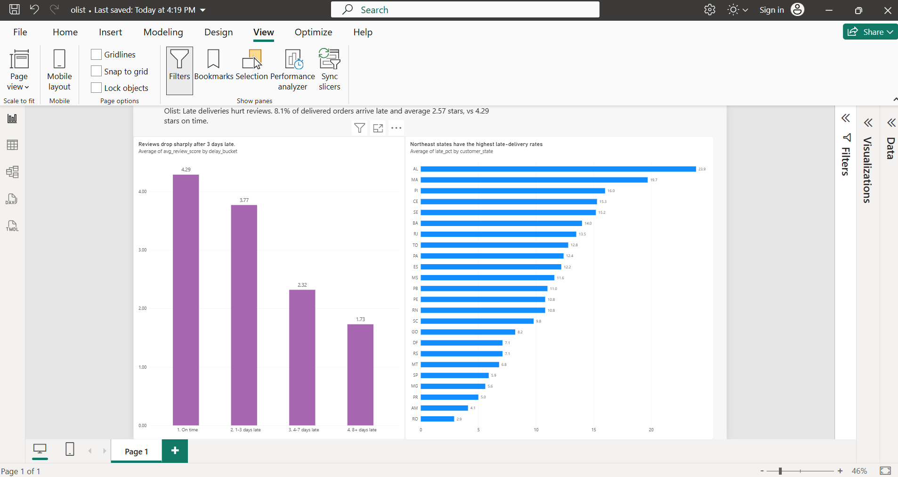

# Olist E-Commerce: Late Deliveries and Customer Reviews

**Business question:** Do late deliveries hurt customer reviews, and where is the problem?

**Tools:** SQL (SQLite), Python (pandas, matplotlib), Power BI

## Key findings

- **8.1% of delivered orders arrive late** (after the estimated delivery date).
- **Late orders average 2.57 stars vs 4.29 for on-time orders**, a gap of 1.7 stars.
- **Reviews collapse after 3 days late:**

| Delivery | Orders | Avg review score |
|---|---|---|
| On time | 88,163 | 4.29 |
| 1-3 days late | 2,636 | 3.77 |
| 4-7 days late | 1,773 | 2.32 |
| 8+ days late | 3,252 | 1.73 |

- **The northeast has the highest late rates:** Alagoas 23.9%, Maranhao 19.7%, Piaui 16.0%.
- **Sao Paulo has the most late orders (2,387) but a low rate (5.9%).** Rio de Janeiro is large and bad: 13.5% late across 12,350 orders.

## Recommendation

Do not treat all late orders the same. Act before an order passes 3 days late: message the customer proactively and offer a discount or priority handling. Investigate the 8+ day orders first, because they are the most common late group and the most damaging. Prioritise Rio de Janeiro and the northeast states, where the problem is both large and severe.

## Method

1. Loaded 9 CSV tables into a SQLite database with Python (`load_data.py`).
2. Kept only delivered orders, since an undelivered order cannot be late (about 97% of orders).
3. Defined "late" as delivered after the estimated delivery date.
4. Wrote SQL (joins, CTEs, CASE, GROUP BY, HAVING) to measure late rates by state and review scores by days late (`queries/`).
5. Charted results with matplotlib (`charts.py`) and built a Power BI dashboard (`olist_dashboard.pbix`).

## Limitations

- This shows correlation, not proof of causation. Very late orders may also have other problems such as lost packages or poor products.
- States with fewer than 100 delivered orders were excluded from the state ranking.
- Reviews are voluntary, so the sample may not represent all customers.

## How to run

1. Download the [Olist dataset from Kaggle](https://www.kaggle.com/datasets/olistbr/brazilian-ecommerce) and put the CSV files in a `data/` folder.
2. `pip install pandas matplotlib`
3. `python load_data.py` to build the database.
4. `python run_sql.py queries/05_reviews_by_days_late.sql` to run any query.
5. `python charts.py` to regenerate the charts.